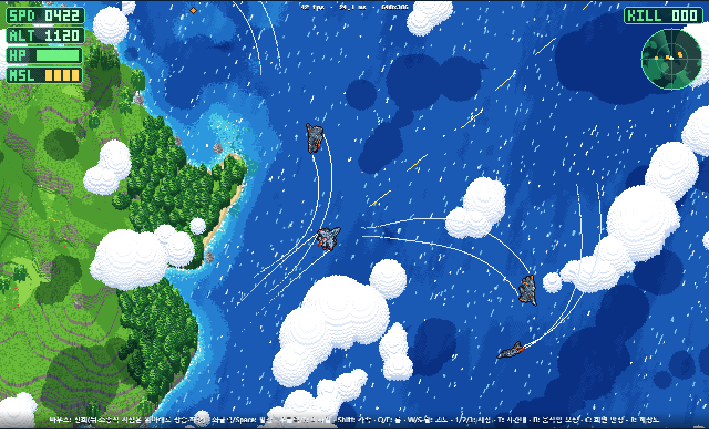
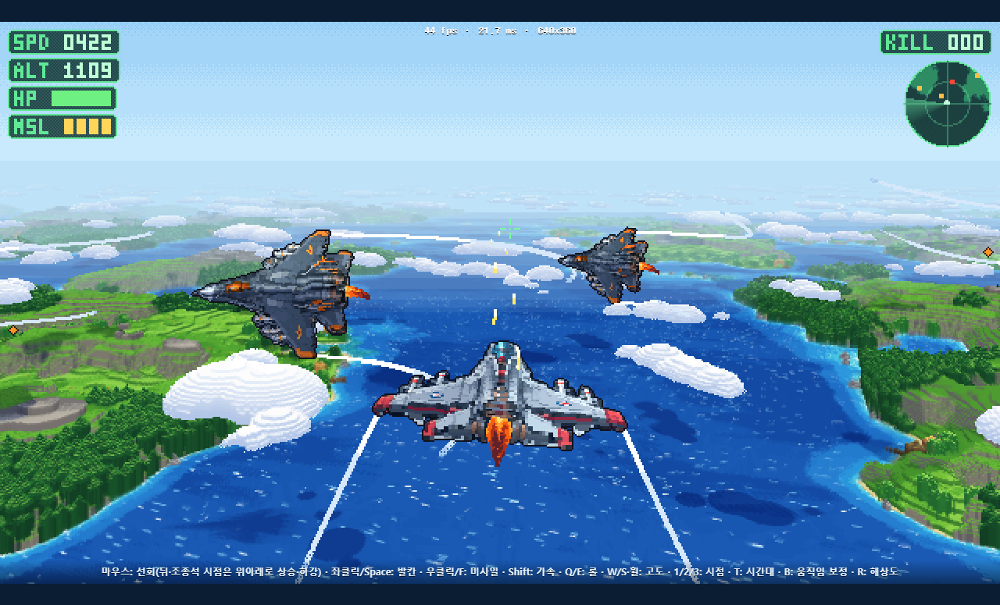
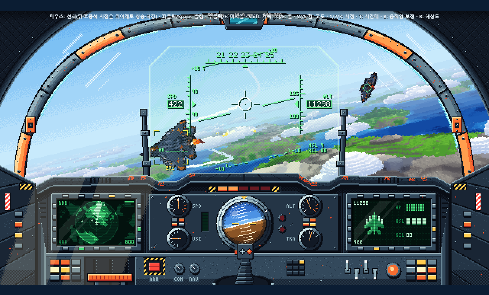

# Sprite Stack Fighter

**▶ 데모: https://leepillwoo.github.io/sprite-stack-fighter/**

`fighter.html` 하나로 실행되는 픽셀아트 공중전 데모입니다. 3D 엔진·폴리곤·외부 이미지 없이, Canvas 2D 픽셀 버퍼에 스프라이트 스태킹(2D 단면을 쌓아 입체를 만드는 기법)으로 직접 그립니다. PC 브라우저와 휴대폰·태블릿(가로 모드, 터치 조작)에서 모두 돌아갑니다.

| 위에서 보기 | 뒤에서 따라가기 | 조종석 |
|---|---|---|
|  |  |  |

## 조작

| PC | 동작 | 터치 |
|---|---|---|
| 마우스 위치 | 선회 (뒤·조종석 시점은 위아래로 상승·하강) | 왼쪽 절반 아무 곳이나 누르면 그 자리에 생기는 조이스틱 (시점마다 조종 방식이 다름, 아래 참고) |
| 좌클릭 / Space | 발칸 | 자동 (적이 기수 앞 가까이 있을 때) |
| 우클릭 / F | 미사일 (락온 대상 → 앞쪽 가장 가까운 적 추적, 5초마다 1발 충전) | 자동 (락온이 잡히면) |
| Shift | 가속 | 가속 |
| Q / E | 롤 | 롤 |
| W / S, 휠 | 고도 | 조이스틱 (뒤·조종석 시점) |
| 1 / 2 / 3 | 시점 (위 / 뒤 / 조종석) | 시점 |
| C | 화면 안정 (멀미가 날 때) | 안정 |
| B | 움직임 보정 (반짝임 줄이기) 강·끔·약 | |
| T | 시간대 (낮 / 노을 / 밤) | |
| M | 소리 켜기/끄기 | 소리 |
| R | 해상도 단계 (1K / 720 / 360 / 150, 기본은 자동) | |

**터치 조종 (시점별)**

- **위에서 보기**: 조이스틱을 민 방향으로 날아갑니다. 고도는 그대로 유지됩니다.
- **뒤에서 따라가기**: 캐주얼. 좌우로 선회, 위로 밀면 상승, 아래로 당기면 하강.
- **조종석**: 실제 비행기처럼. 좌우는 롤(놓아도 기울기가 유지되고, 기울기만큼 선회), 아래로 당기면 기수가 들리고 위로 밀면 숙여집니다. 기울인 채 당기면 더 급하게 돕니다.

주소 뒤에 `?debug` 를 붙이면 fps 가 보이고, `?tier=0`~`3` 으로 해상도 단계(1K / 720 / 360 / 150)를 고정합니다.

## 특징

- **렌더러**: 섬과 구름은 높이맵 기둥을 앞에서부터 쌓아 그리는 소프트웨어 렌더러, 기체는 회전하는 복셀 단면 스택. 세 시점이 한 카메라의 연속 이동이라 전환이 끊기지 않습니다.
- **기체**: Codex 가 그린 4면도(`design/*_jet_orthos.png`)에서 복셀을 자동으로 깎아 만듭니다.
- **전투**: 발칸, 락온 미사일, 적기 AI, 폭발·추락·연기, 레이더와 픽셀아트 조종석 HUD.
- **화면 대응**: 4:3 태블릿부터 21:9 휴대폰·울트라와이드까지 창을 채우고, 기기 픽셀 기준 정수배로 확대해 도트가 번지지 않습니다. 해상도는 1K / 720 / 360 / 150 네 단계로, 360에서 시작해 기기 성능에 따라 자동으로 오르내립니다(R 키로 직접 선택).

## 개발

**`fighter.html` 은 빌드 결과물입니다. 직접 고치지 말고 소스를 고친 뒤 다시 빌드합니다.** (Node.js 18 이상, 외부 패키지 없음)

```
node tools/build.mjs        # src/ + parts/ → fighter.html
node tools/smoke.mjs        # 헤드리스로 45초 비행시켜 깨지는 곳이 없는지 확인
node tools/bench.mjs        # 시점별 프레임 시간
node tools/flicker.mjs      # 움직임 보정(끔/약/강)별 화면 반짝임 측정
node tools/wobble.mjs       # 움직임 보정이 화면을 밀어내지 않는지(울렁임) 측정
node tools/build_jets.mjs   # design/*_jet_orthos.png → parts/jets.js
```

| 경로 | 내용 |
|---|---|
| `src/engine.js` | 렌더러, 비행, 전투 |
| `src/main.js`, `src/shell.html` | 캔버스·입력·루프, 페이지 껍데기 |
| `parts/cockpit.js` | 조종석·HUD 아트 |
| `parts/jets.js` | 기체 복셀 데이터 (자동 생성) |
| `design/` | 디자인 시안 |
| `screenshots/` | 시점별·기기별 스크린샷 |

참고: UI8 Forge 의 [fighter](https://remix.ui8.ai/fly) 데모에서 기법을 참고해 새로 구현했습니다.
